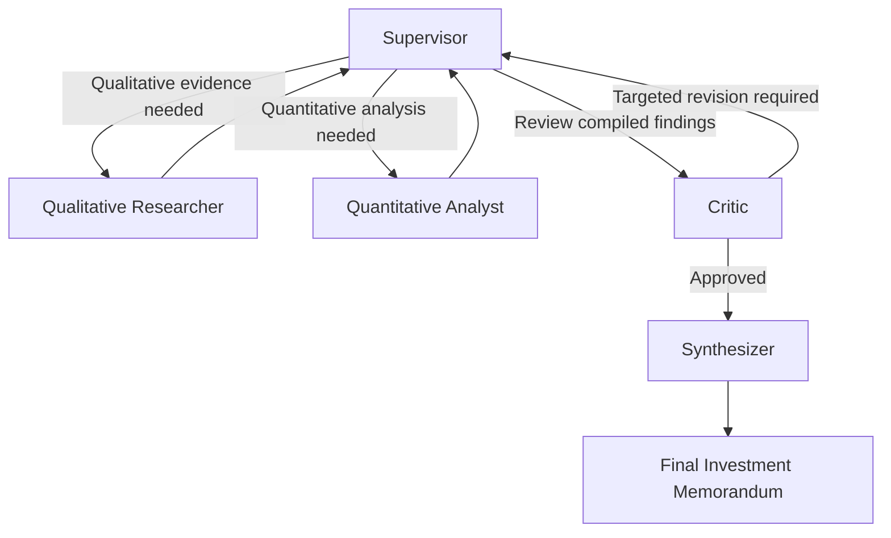

# Tesla Corporate Due Diligence: Multi-Agent Investment Analysis

A LangGraph-powered multi-agent system that researches, analyzes, critiques, and synthesizes evidence into a structured investment memorandum on Tesla. The project moves beyond a single sequential agent pipeline to a supervisor-orchestrated workflow in which specialized agents collaborate through shared graph state.

> **Important:** This project is an analytical and engineering demonstration, not financial advice. Valuations and recommendations depend on the quality, completeness, and freshness of the underlying data.

## Table of Contents

- [Overview](#overview)
- [Architecture: The Star Graph](#architecture-the-star-graph)
- [Agents and Responsibilities](#agents-and-responsibilities)
- [Workflow](#workflow)
- [Engineering Challenges and Solutions](#engineering-challenges-and-solutions)
- [Final Output](#final-output)
- [Technology Stack](#technology-stack)
- [Setup](#setup)
- [Configuration](#configuration)
- [Run the Project](#run-the-project)
- [Project Structure](#project-structure)
- [Limitations and Responsible Use](#limitations-and-responsible-use)

## Overview

The system performs corporate due diligence for an investment analysis of **Tesla**. Its goal is to coordinate a team of specialized agents that can:

- Gather qualitative evidence about the business, news, market sentiment, and key events.
- Analyze financial metrics, forecasts, comparable-company multiples, and discounted cash flow (DCF) valuation.
- Critique the combined findings for contradictions, omissions, and weak reasoning.
- Route targeted revisions to the relevant worker when problems are identified.
- Synthesize approved findings into a formatted Markdown investment memorandum.

The graph uses typed state and conditional routing to coordinate work, retain critic feedback, and support checkpointing.

## Architecture: The Star Graph

Rather than forcing every task through a rigid linear chain, the system uses a **star graph** topology. A central **Supervisor** controls delegation and receives results from each worker.



The Supervisor reads the global state and routes work based on flags such as `revision_pending`, `has_qual`, and `has_quant`. Workers return their findings to the Supervisor, which evaluates the updated state and determines the next action.

## Agents and Responsibilities

### 1. Supervisor

The central orchestration node. It coordinates the workflow, tracks completion flags, and decides whether to delegate research, request quantitative analysis, send findings for critique, route a revision, or proceed to synthesis.

Key state flags include:

- `revision_pending` — whether a revision is required.
- `has_qual` — whether qualitative findings are available.
- `has_quant` — whether quantitative findings are available.

### 2. Qualitative Researcher

Collects and organizes narrative evidence, including business developments, relevant news, market sentiment, and key events. Its findings provide context for the financial analysis and investment thesis.

### 3. Quantitative Analyst

Works on financial metrics, forecasts, comparable-company multiples, and discounted cash flow (DCF) modeling. The analyst's assumptions should remain consistent with the qualitative evidence and the broader investment thesis.

### 4. Critic

Acts as a quality-control layer. It reviews the research and quantitative outputs for contradictions, missing evidence, and logical flaws.

When it rejects a draft, it identifies the relevant `target_agent` and supplies targeted feedback. The Supervisor uses this feedback to route the revision to the appropriate worker.

### 5. Synthesizer

After the Critic approves the compiled findings, the Synthesizer converts them into the final Markdown investment memorandum, with a consistent structure and clear presentation.

## Workflow

1. **Inspect state:** The Supervisor checks which findings are available and whether a revision is pending.
2. **Delegate work:** The Supervisor routes missing qualitative or quantitative work to the appropriate agent.
3. **Return findings:** Each worker updates the graph state and reports back to the Supervisor.
4. **Critique:** The Critic checks the combined findings for quality, consistency, and gaps.
5. **Revise when needed:** If the Critic rejects the draft, the Supervisor routes targeted feedback to the relevant worker.
6. **Synthesize:** Once the Critic approves the findings, the Synthesizer creates the final investment memorandum.

## Engineering Challenges and Solutions

### State thrashing and revision oscillation

**Problem:** The Critic could reject the Analyst's work, after which the Analyst would revise an assumption that caused the Critic to reject the Researcher's work. This could create a repetitive revision loop.

**Solution:** The agents' prompts were designed to expose relevant cross-agent findings. For example, the Analyst receives the Researcher's draft and the Researcher receives relevant quantitative context. Sharing this state helps agents align their assumptions before the Critic reviews the combined work.

### Strict structured-output and tool-call enforcement

**Problem:** Smaller language models can struggle with strict schemas and tool-calling instructions. They may return plain text where a structured response is expected or attempt to use a tool that does not exist.

**Solution:** Prompts explicitly constrain the expected output format and map complex analysis to defined schema fields. Formatting pitfalls—such as Python-style numeric underscores in values—are also called out to reduce invalid output.

### Typed state and Pydantic models

The graph uses a strictly typed `OverallGraphState` and Pydantic models such as:

- `QualitativeFindings`
- `QuantitativeFindings`
- `CriticFeedback`

Reducers such as `operator.add` allow critic feedback history to be appended rather than overwritten, preserving the sequence of review and revision events.

### Serialization and checkpoint persistence

A `MemorySaver` checkpointer supports in-memory checkpointing during a run. To accommodate custom Pydantic types during serialization and deserialization, the project configures a `JsonPlusSerializer` allowlist in response to LangGraph's serialization and security requirements.

> Check the installed LangGraph version's serializer documentation before changing the allowlist. Only allow types that the application needs and trusts.

## Final Output

The system produces a structured Markdown investment memorandum intended to include:

- Executive summary
- Business overview
- Financial summary
- DCF valuation and key assumptions
- Risk assessment
- Final investment recommendation

The workflow is designed to incorporate real-world uncertainty and evolving business developments. For example, the analysis surfaced Tesla's delayed expansion plans, including the pause associated with Gigafactory Mexico.

The output's reliability depends on source quality, the data date, the assumptions used, and whether calculations and claims are independently verified.

## Technology Stack

- **Python** — application language
- **LangGraph** — graph orchestration, conditional routing, and checkpointing
- **LangChain Groq integration** — access to supported Groq-hosted models
- **LangChain OpenAI integration** — access to supported OpenAI models
- **Pydantic** — typed state and structured findings
- **python-dotenv** — loading environment variables from a `.env` file

## Setup

### Prerequisites

- Python installed in your environment
- API keys for whichever model providers the implementation uses
- Terminal access from the project directory

### 1. Clone or download the project

If the project is hosted in a Git repository:

```bash
git clone <your-repository-url>
cd <your-project-directory>
```

If you already have the source code locally, open a terminal in the project directory.

### 2. Create and activate a virtual environment

```bash
python -m venv .venv
```

Activate it on Windows:

```powershell
.venv\Scripts\Activate.ps1
```

Or on macOS/Linux:

```bash
source .venv/bin/activate
```

### 3. Install dependencies

Install the dependencies used by the project:

```bash
pip install langgraph langchain-groq langchain-openai pydantic python-dotenv
```

If the repository includes a `requirements.txt`, prefer installing from it:

```bash
pip install -r requirements.txt
```

## Configuration

Create a `.env` file in the project root and add the API keys required by your implementation. For example:

```dotenv
GROQ_API_KEY=your_groq_api_key
OPENAI_API_KEY=your_openai_api_key
```

Use only the provider keys required by the models configured in your code. The exact variable names must match those read by `graph.py` and any related modules.

**Security:** Do not commit `.env` or API keys to version control. Add `.env` to `.gitignore`:

```gitignore
.env
.venv/
__pycache__/
*.py[cod]
```

## Run the Project

From the project root, with the virtual environment activated and environment variables configured, run:

```bash
python graph.py
```

The entry point is `graph.py`. Follow the console output and inspect the generated Markdown memorandum or the output location configured by the implementation.

## Project Structure

A possible high-level structure is shown below. Adjust it to match the actual repository files.

```text
project-root/
├── graph.py                 # Graph construction and entry point
├── .env                     # API keys (do not commit)
├── .gitignore
├── requirements.txt         # Optional dependency lock/list
└── README.md
```

If agents, schemas, prompts, or tools are separated into other modules, include those files in the tree as appropriate.

## Limitations and Responsible Use

- **Not financial advice:** The report is a research artifact, not a personalized investment recommendation.
- **Verify evidence:** Check material claims against primary sources and note the date of the data.
- **Validate calculations:** Independently verify DCF inputs, comparable-company selection, forecast assumptions, and valuation outputs.
- **Expect model errors:** Structured output and critic review reduce some failure modes but do not guarantee factual correctness.
- **Respect data freshness:** News, financial statements, prices, and corporate plans change. Avoid treating an old run as a current view of Tesla.
- **Protect credentials:** Keep API keys out of source control, logs, and generated reports.

---

## Project Summary

This project demonstrates how a supervisor-led LangGraph system can coordinate specialized research and analysis agents, use a critic to trigger targeted revisions, maintain typed shared state, and synthesize approved findings into an investment memorandum.
